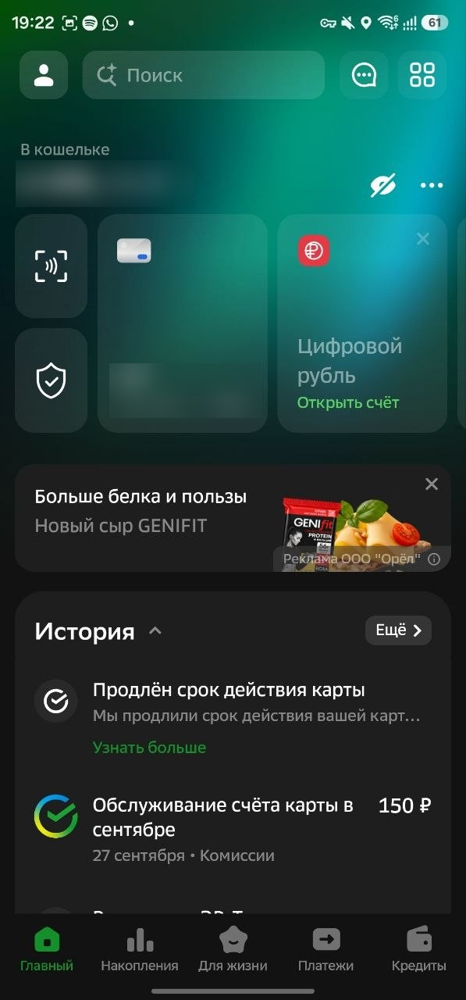
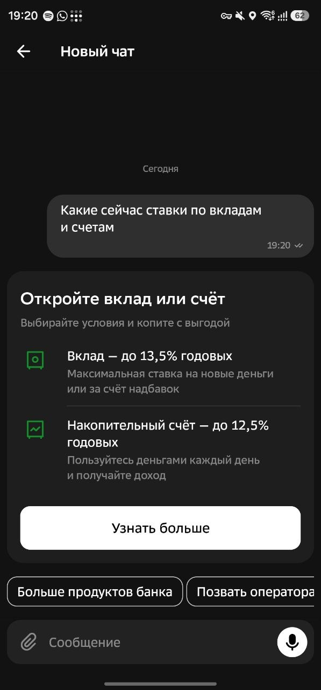
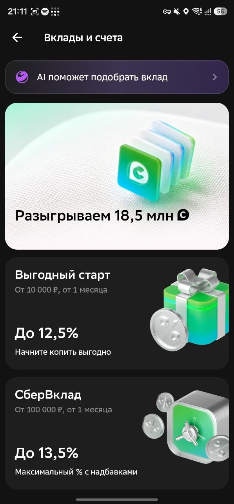
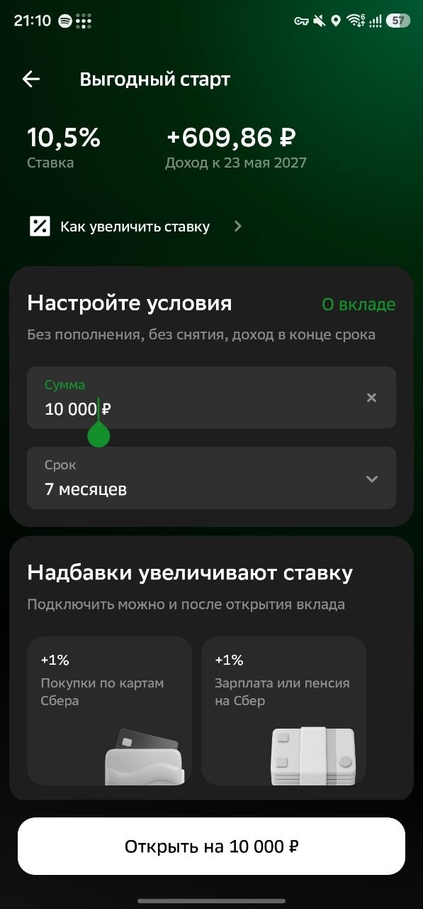
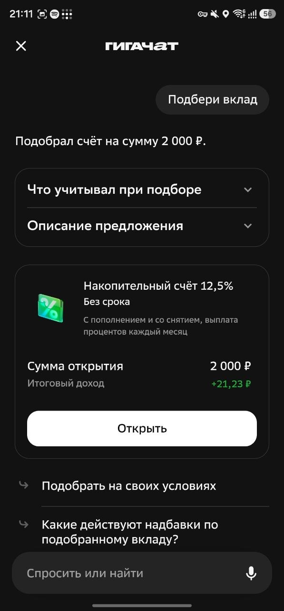

# Ставка 2. «Первые деньги»

*Новая ставка GenAI-лаборатории. Часть [плана на 100 дней](../README.md). Факты — в [исследовании](../01-research/synthesis.md), ссылки вида (Q9). «Допущение» — наша оценка, уточним по данным Сбера.*

## Коротко

В 18–24 года у человека появляются первые деньги: зарплата, регулярные поступления, заметная сумма на счёте. В этот момент он выбирает основной банк. У Сбера есть всё, что ему нужно: накопительный счёт, вклад, инвестиции, кредиты. Но каждый продукт живёт в своём разделе, и никто не помогает собрать из них путь к цели.

«Первые деньги» — карточка на главном экране, которая открывает чат: в веб-СБОЛ и в приложениях на Android и iOS. Человек говорит, на что копит. Модель отвечает интерактивными виджетами: план, сравнение «копить или взять кредит», разбор трат. Путь заканчивается открытым продуктом. Ставки, суммы и условия модель не пишет: их считают системы банка.

|                                    |                                                                                                                                                                                                                                      |
| ---------------------------------- | ------------------------------------------------------------------------------------------------------------------------------------------------------------------------------------------------------------------------------------ |
| Гипотеза                           | Чат с интерактивными виджетами и персональными рекомендациями под цель человека приводит к открытию продуктов чаще, чем тот же чат с текстом и ссылками                                                                              |
| Для кого                           | 18–24 года с первыми деньгами. Подростки 16–17 с родителем — позже                                                                                                                                                                   |
| Где запускаем                      | Карточка на главном экране: веб-СБОЛ и приложения на Android и iOS. Карточка открывает чат. Если в приложениях не получится, запускаемся с веба                                                                                      |
| Kill за 2 недели                   | До разработки: пуш в момент первых денег не поднимает открытия продуктов, или людей в триггерах слишком мало. После релиза: чат с виджетами хуже чата с текстом и ссылками по конверсии в открытие продукта и/или в заявку на кредит |
| Бизнес-метрики                     | Конверсия в открытие накопительного счёта, вклада и брокерского счёта. Заявки на кредиты. Приток денег на человека. Доля тех, для кого Сбер стал основным банком                                                                     |
| Пример эффекта                     | Прибыль до налога ~12 млн ₽ за первый год после пилота и ~120 млн ₽ за третий — на четырёх продуктах. Расчёт — в разделе «1. Контекст»                                                                                               |
| Что пройти руками к концу квартала | Студентка с первой зарплатой проходит путь от карточки на главной до открытого накопительного счёта. Сценарий — в разделе «4. Что человек пройдёт к концу квартала». [Прототип](https://pervye-dengi.178.105.202.173.sslip.io/), [макеты](https://claude.ai/artifact/XTyfu1aqnaDQ4rMCbxxaLj#page-dcb81aee8d83)                                                                  |

**Что внутри ставки:** чат «Первые деньги» с виджетами под цель. Запуститься можно с одним-двумя виджетами, остальные добавляем по мере готовности.

**Результат:** к 2-й неделе знаем, нужна ли ставка людям. К дню 100 знаем, нужны ли виджеты. Знаем, сколько людей открывают продукты и подают заявки. Есть список следующих виджетов по приоритету. Есть решение по комплаенсу, можно ли показывать инвестиции.

## 1. Контекст

**Задача.** Вторая цель года — финансовый эффект. У детей 6–13 денег почти нет. Деньги сегмента — у 16–24 ([Q9](../01-research/q9-metrics-baseline.md)):
- Приток в молодёжные вклады вырос за год с 0,1 до 7,6 млрд ₽ в месяц.
- У 18–24 средний брокерский портфель — около 104 тыс. ₽.
- За 11 месяцев 2025 года выдано больше 128 тыс. образовательных кредитов.

**Почему момент первых денег.** В 14–17 лет счёт в Сбере есть у 94% подростков. В 18–24 конкуренция банков сильнее ([Q2](../01-research/q2-mau.md)). Первые деньги — момент, когда человек решает, где их держать. Банк видит этот момент сам. Человеку не нужно ничего заполнять.

**Пример из США.** Cleo — финансовый ассистент в чате для поколения Z. Молодые люди обсуждают с ним траты и цели и платят за это подписку: у Cleo 743 тыс. платящих и около $280 млн выручки в год по внешней оценке ([Q3](../01-research/q3-banking-genai.md)). Своих продуктов у Cleo нет, поэтому разговор заканчивается советом.

**Почему у Сбера получится.** Под одну цель нужен набор продуктов: накопительный счёт, вклад, инвестиции, образовательный кредит, ипотека, автокредит, совместный счёт с близкими ([Q9](../01-research/q9-metrics-baseline.md), [Q13](../01-research/q13-school-and-sber-assets.md)). Всё это у Сбера уже есть. Поэтому путь заканчивается не советом, а открытым счётом.

**Путь уже существует, но он рваный.** Сегодня из чата банка до вклада ведут четыре экрана: карточка в чате, список вкладов, страница вклада с калькулятором или отдельный ГигаЧат. Виджеты в этом пути не интерактивные, а цель человека никто не спрашивает. Скриншоты — в разделе «Приложение» в конце документа.

**Почему это делает лаборатория.** Каждая продуктовая команда отвечает за свой продукт. Связать вклад, инвестиции и кредит в один путь к цели не может ни одна из них. Вариантов пути слишком много: цели, доходы и траты у всех разные. Модель собирает каждый шаг из одного каталога виджетов. Виджеты, однажды согласованные с юристами, пригодятся и для других жизненных событий.

**GenUI vs Статика.** Статичный калькулятор внутри чата смысла не имеет. Поэтому статика — тот же чат, только вместо виджетов текст и ссылки на открытие продуктов. В тесте это отдельная тестовая группа рядом с виджетами. Этот же вариант показываем, когда виджет не собрался. Если виджеты не обыгрывают текст, генерацию закрываем.

**Связь с деньгами банка.** В СБОЛ около 7 млн активных пользователей 18–24 лет ([Q2](../01-research/q2-mau.md)). Первые деньги за год появляются примерно у 15% из них — это около 1 млн человек (допущение). Каждый процентный пункт конверсии — 10 тыс. человек в продукте. Банк зарабатывает на каждом продукте пути:

| Продукт | Как зарабатывает банк | Что нужно, чтобы посчитать |
|---|---|---|
| Накопительный счёт и вклад | Маржа на остатке | Внутренняя ставка банка, средний остаток у молодых клиентов |
| Брокерский счёт | Комиссии за сделки и обслуживание | Средний портфель и оборот у 18–24 |
| Образовательный кредит | Процентный доход. По кредиту с господдержкой разницу до рыночной ставки доплачивает государство ([Q13](../01-research/q13-school-and-sber-assets.md)) | Средняя сумма и ставка компенсации |
| Ипотека и автокредит | Процентный доход и страховки | Средняя сумма и маржа по молодым заёмщикам |
| Совместный счёт с близкими | Маржа на деньгах родственников, которые приходят в цель | Средний взнос близких |

**Пример. Инкрементальный эффект «Первых денег»**

| Метрика | Ед. | Pilot | 1Y Q1 | 1Y Q2 | 1Y Q3 | 1Y Q4 | **1Y** | 2Y | 3Y |
|---|---|---|---|---|---|---|---|---|---|
| Люди с первыми деньгами в охвате за период* | тыс. | 40 | 60 | 125 | 250 | 250 | **685** | 1 000 | 1 000 |
| **Накопительный счёт** | | | | | | | | | |
| Дополнительные открытия* | % охвата | 1,5 | 1,5 | 1,5 | 1,5 | 1,5 | **1,5** | 1,5 | 1,5 |
| Средний остаток* | тыс. ₽ | 50 | 50 | 50 | 50 | 50 | **50** | 50 | 50 |
| Остатки | млн ₽ | 30 | 75 | 169 | 356 | 544 | **544** | 1 294 | 2 044 |
| Разница между внутренней ставкой банка и ставкой клиенту* | % | 2,5 | 2,5 | 2,5 | 2,5 | 2,5 | **2,5** | 2,5 | 2,5 |
| Чистый процентный доход | млн ₽ | 0,1 | 0,3 | 0,8 | 1,6 | 2,8 | **5,5** | 23,0 | 41,7 |
| **Вклад** | | | | | | | | | |
| Дополнительные открытия* | % охвата | 0,5 | 0,5 | 0,5 | 0,5 | 0,5 | **0,5** | 0,5 | 0,5 |
| Средний вклад* | тыс. ₽ | 200 | 200 | 200 | 200 | 200 | **200** | 200 | 200 |
| Остатки | млн ₽ | 40 | 100 | 225 | 475 | 725 | **725** | 1 725 | 2 725 |
| Разница между внутренней ставкой банка и ставкой клиенту* | % | 2,0 | 2,0 | 2,0 | 2,0 | 2,0 | **2,0** | 2,0 | 2,0 |
| Чистый процентный доход | млн ₽ | 0,1 | 0,4 | 0,8 | 1,8 | 3,0 | **5,9** | 24,5 | 44,5 |
| **Брокерский счёт** | | | | | | | | | |
| Дополнительные открытия* | % охвата | 1,0 | 1,0 | 1,0 | 1,0 | 1,0 | **1,0** | 1,0 | 1,0 |
| Средний портфель* | тыс. ₽ | 30 | 30 | 30 | 30 | 30 | **30** | 30 | 30 |
| Портфели | млн ₽ | 12 | 30 | 68 | 143 | 218 | **218** | 518 | 818 |
| Комиссии к портфелю* | % в год | 1,5 | 1,5 | 1,5 | 1,5 | 1,5 | **1,5** | 1,5 | 1,5 |
| Чистый комиссионный доход | млн ₽ | 0,0 | 0,1 | 0,2 | 0,4 | 0,7 | **1,3** | 5,5 | 10,0 |
| **Образовательный кредит** | | | | | | | | | |
| Дополнительные выдачи* | % охвата | 0,2 | 0,2 | 0,2 | 0,2 | 0,2 | **0,2** | 0,2 | 0,2 |
| Средняя сумма* | тыс. ₽ | 300 | 300 | 300 | 300 | 300 | **300** | 300 | 300 |
| Кредитный портфель | млн ₽ | 24 | 60 | 135 | 285 | 435 | **435** | 1 035 | 1 635 |
| Процентный спред с учётом субсидии* | % | 3,5 | 3,5 | 3,5 | 3,5 | 3,5 | **3,5** | 3,5 | 3,5 |
| Стоимость риска* | % | 1,0 | 1,0 | 1,0 | 1,0 | 1,0 | **1,0** | 1,0 | 1,0 |
| Чистый процентный доход за вычетом стоимости риска | млн ₽ | 0,1 | 0,3 | 0,6 | 1,3 | 2,3 | **4,4** | 18,4 | 33,4 |
| **Операционный доход, итого** | млн ₽ | **0,3** | **1,0** | **2,4** | **5,1** | **8,7** | **17,2** | **71,4** | **129,6** |
| Операционные расходы: вычисления** | млн ₽ | 0,3 | 0,5 | 1,0 | 2,0 | 2,0 | **5,5** | 8,0 | 8,0 |
| **Прибыль до налога** | млн ₽ | **0,0** | **0,5** | **1,4** | **3,1** | **6,7** | **11,7** | **63,4** | **121,6** |

Pilot — 100 дней. 1Y — первый год после пилота, Q1–Q4 — его кварталы. Деньги — за период, численность и остатки — на конец периода.
\* Допущение, уточним по данным Сбера.
\*\* 20% охвата начинают чат, 40 ₽ за сессию по публичным ценам GigaChat ([Q6](../01-research/q6-genui.md)).

## 2. Что делаем

**Три триггера.** Карточку «Первые деньги» показываем, когда банк видит одно из трёх событий:
1. Пришла первая зарплата или человек оформил зарплатную карту.
2. Появились регулярные поступления: стипендия, подработка, переводы.
3. Остаток на счёте впервые превысил заметную сумму. Порог подберём по данным.

Как и с виджетами, запуститься можно с одним триггером. Какой первый — решим по данным: сколько людей в каждом и насколько точно он срабатывает.

**Виджеты-кандидаты.** Каждый виджет решает одну задачу человека и ведёт к одному продукту банка:

| Задача человека | Виджет | Продукт банка |
|---|---|---|
| Пришли деньги, непонятно, что с ними делать | Выбор цели и план: сколько откладывать, куда и сколько ждать | Накопительный счёт, вклад |
| Хочется, чтобы деньги работали | Симуляция инвестиций с диапазоном результата | Брокерский счёт |
| Непонятно, копить или брать кредит | Сравнение: платёж, переплата, срок | Образовательный кредит, ипотека, автокредит |
| Откладывать не из чего | Разбор трат: сколько можно сэкономить и насколько ближе станет цель | Автоперевод в цель |
| Копить в одиночку долго | Приглашение близких в цель | Совместный счёт |

**Цели в чате:** подушка, отпуск, учёба, машина, квартира.

**Приоритеты.** Все виджеты за 100 дней не сделать, и это не нужно. Запуститься можно с одним-двумя. Порядок выбираем по двум вещам: сколько денег виджет может принести и насколько просто его сделать. Для этого нужны данные изнутри Сбера: сколько людей попадает в каждый триггер, какие продукты они уже открывают и сколько банк зарабатывает на каждом. Запросим их в первую неделю.

**Что дальше, после квартала:** остальные виджеты по списку. Подростки 16–17 вместе с родителем. Другие жизненные события: 18 лет, поступление, переезд, первая крупная покупка.

## 3. Как устроено

- Движок общий со ставкой 1. Подробно — в [спецификации прототипа](../docs/process/2026-10-22-prototype-engine-design.md).
- Модель ведёт диалог и в нужный момент вставляет в чат виджет из каталога.
- Ставки, платежи и доходность считают калькуляторы банка. Модель только выбирает, какой расчёт показать.
- Открытие продукта, согласия и юридические условия — обычные статичные экраны. Модель не может их изменить.
- Триггеры строим на истории операций. Точность каждого проверяем до запуска.
- Разбор трат использует категории операций, которые уже есть в СБОЛ.
- Карточку и чат делаем в веб-СБОЛ и в приложениях на Android и iOS. Если с приложениями не выйдет, запускаемся с веба. Новый виджет в вебе появляется сразу, в приложениях — с ближайшим релизом. Веб важен ещё и потому, что 59% людей 20–24 лет пользуются iPhone, а приложения Сбера нет в App Store ([Q2](../01-research/q2-mau.md)).

## 4. Что человек пройдёт к концу квартала

[👉 Прототип](https://pervye-dengi.178.105.202.173.sslip.io/) · [🎨 Макеты](https://claude.ai/artifact/XTyfu1aqnaDQ4rMCbxxaLj#page-dcb81aee8d83)

> [!WARNING]
> **Обновление страницы НЕ сбрасывает демо.** Состояние хранится на сервере и одно на всех. Чтобы начать с начала, нажмите **«Сбросить демо»** вверху страницы.

Маша, 19 лет, студентка. На её молодёжную карту Сбера пришла первая зарплата.

| Шаг | Что видит Маша | Что сделала модель |
|---|---|---|
| 1 | На главной СБОЛ карточка: «Первые деньги — поздравляем! Давай решим, что с ними делать» | Ничего: карточку показал триггер «первая зарплата» |
| 2 | Чат: «На что копишь?» Маша выбирает «своя квартира» | Предложила цели, подходящие её возрасту и доходу |
| 3 | План: накопительный счёт и инвестиции. Ползунки срока и ежемесячной суммы. Результат показан диапазоном | Вставила виджет плана. Цифры посчитал калькулятор банка |
| 4 | Сравнение «копить или взять ипотеку сейчас»: платёж, переплата, требования | Добавила сравнение, потому что цель — квартира |
| 5 | Разбор трат: «На доставку уходит 6 400 ₽ в месяц. Если вдвое меньше, квартира станет ближе на 4 месяца» | Выбрала категорию трат, которая сильнее всего двигает цель |
| 6 | Приглашение маме вкладываться в цель через совместный счёт | Предложила подключить близких |
| 7 | Открытие накопительного счёта на обычном экране с условиями | Ничего: это статичный экран |
| Виджет не собрался | Текст с планом и ссылка на открытие накопительного счёта | Ничего: показан запасной вариант |

В сценарии показаны все виджеты. На запуске их может быть один-два.

## 5. Как измеряем

Сначала за 2 недели проверяем, нужна ли ставка людям. Для этого разработка не нужна. После релиза проверяем генерацию и бизнес-эффект.

**Проверка до разработки, 2 недели:**
- **Исследования.** Поднимаем существующие исследования Сбера о молодых клиентах. Проводим 10 интервью: на что люди тратят и копят первые деньги, где их держат, как выбирают банк. Это объясняет цифры из данных.
- **Данные.** Смотрим людей, которые за прошлый год попали в каждый триггер. Сколько из них открыли накопительный счёт, вклад или брокерский счёт за 1–3 месяца. Сколько перевели зарплату в другой банк. Kill: людей в триггерах мало, или они и так открывают продукты без нашей помощи.
- **Пуш в момент первых денег.** Части людей из триггера отправляем пуш «Первые деньги — поздравляем! Узнай как их сохранить и приумножить». Пуш ведёт на существующие страницы накоплений и инвестиций. Пуши настраиваются на сервере, релиз не нужен. Kill: открытий продуктов не больше, чем у тех, кто пуш не получил. Значит, момент первых денег не работает.
- **Прототип.** 10–15 человек с первой зарплатой проходят наш чат с виджетами и тот же чат с текстом. Kill: виджеты непонятны, или с ними люди не доходят до плана чаще.

После релиза проводим минимум два теста.

**A/B-тест, до 4 недель.** Людей с первыми деньгами делим на три группы: контрольная не видит карточку, первая тестовая получает чат с текстом и ссылками, вторая — чат с виджетами. Смотрим:
- Долю нажавших на карточку.
- Долю дошедших до плана.
- Конверсию в открытие накопительного счёта, вклада и брокерского счёта.
- Заявки на образовательный кредит, ипотеку и автокредит.
- Включённые автопереводы в цель.
- Приглашённых близких.

Через 2 недели решаем: если чат с виджетами хуже чата с текстом и ссылками по конверсии в открытие продукта и/или в заявку на кредит, закрываем генерацию.

**Тест против холдаута, 3–6 месяцев.** Победитель A/B-теста остаётся против контрольной группы. Она становится холдаутом и до конца теста не видит карточку. Смотрим:
- Приток и остатки на накопительных счетах, вкладах и брокерских счетах на человека.
- Долю тех, кто пополняет цель через 1 и 3 месяца.
- Выданные кредиты.
- Долю тех, для кого Сбер стал основным банком. Определение основного банка берём у Сбера.

По этому тесту решаем, масштабировать ли чат.

**Guardrails и контрметрики:** заявок на кредит от людей с высокой долговой нагрузкой не становится больше. Комплаенс выборочно читает диалоги и не находит обещаний доходности и советов купить конкретную бумагу. Вместо виджета показываем текст не больше чем в 20% случаев. Обращения в поддержку растут незначительно.

**Каких данных не хватает.** Чтобы посчитать размер групп и цели, нужны число людей в каждом триггере в месяц, текущая доля открытий продуктов в этом сегменте и средний остаток. Запросим в первую неделю.

## 6. План на 100 дней

| Недели | Что делаем                                                                                                                                                                        | Что решаем                                                                                         |
| ------ | --------------------------------------------------------------------------------------------------------------------------------------------------------------------------------- | -------------------------------------------------------------------------------------------------- |
| 1–2    | Проверка до разработки: исследования, данные, пуш, прототип. Расставляем приоритеты триггеров и виджетов. Параллельно запускаем комплаенс и просим место на главной СБОЛ в релизе | Потребность не подтвердилась — закрываем ставку. Подтвердилась — выбираем первый триггер и виджеты |
| 3–8    | Разрабатываем чат: первый триггер, первые виджеты, текст и ссылки для группы со статикой, подключение продуктов и калькуляторов                                                   | Запускаемся с теми виджетами, что готовы. Одного-двух достаточно                                   |
| 9–12   | A/B-тест на людях с первыми деньгами. Контрольная группа остаётся холдаутом                                                                                                       | На 11-й неделе: если виджеты хуже текста, закрываем генерацию                                      |
| 9–14   | Делаем следующие виджеты по списку приоритетов                                                                                                                                    | Готовый виджет выкатываем в вебе сразу, в приложениях — с ближайшим релизом                            |
| 13–14  | Тест против холдаута продолжается                                                                                                                                                 | Показываем демо, планируем масштабирование                                                         |

**После 100 дней.** Если эффект против холдаута держится три месяца, показываем карточку всем людям с первыми деньгами. Добавляем виджеты по списку, инвестиции — если комплаенс разрешил. Подключаем подростков 16–17 вместе с родителем. Переносим движок на другие жизненные события.

## 7. Риски

| Риск | Насколько серьёзно | Что делаем |
|---|---|---|
| Комплаенс не разрешает показывать инвестиции без статуса инвестсоветника | Высокое влияние, средняя вероятность | Запускаемся без виджета инвестиций. Добавляем его позже через компанию группы со статусом |
| Чат выглядит как навязывание кредита молодым | Высокое влияние, средняя вероятность | Кредит показываем только в сравнении и только по цели, которую выбрал сам человек. Платёж и долговая нагрузка — на статичных экранах |
| Модель пообещает доходность или назовёт неверную ставку. За обещания сумм Cleo оштрафовали на $17 млн ([Q3](../01-research/q3-banking-genai.md)) | Высокое влияние, средняя вероятность | Модель не пишет цифры, их считают калькуляторы банка. Доходность показываем диапазоном. Проверка блокирует виджет с цифрой не из системы |
| Большая часть 20–24 сидит на iPhone, а приложения нет в App Store | Высокое влияние, высокая вероятность | Если в приложениях не выйдет, основной канал — веб-СБОЛ. Проверяем, можно ли открыть веб из уведомления старого приложения на iPhone |

## 8. Что нам нужно от других

| От кого                                    | Что                                                       | Когда               | Если не получим                                   |
| ------------------------------------------ | --------------------------------------------------------- | ------------------- | ------------------------------------------------- |
| Владелец главного экрана СБОЛ и приложений | Место для карточки у людей с первыми деньгами             | Просим в 1-ю неделю | Вход только через уведомление и чат, охват ниже   |
| Офис данных                                | История операций для триггеров и данные для приоритетов   | 1-я неделя          | Нет триггеров — нет запуска                       |
| Команда пушей                              | Пуш части сегмента для проверки до разработки             | 1-я неделя          | Проверяем потребность только по данным и интервью |
| Вклады, СберИнвестиции, кредиты            | Условия продуктов и открытие через API                    | К 4-й неделе        | Чат заканчивается советом, а не открытым счётом   |
| Комплаенс и юристы                         | Заключение по каталогу и ответ про статус инвестсоветника | 1–2-я недели        | Чат без инвестиций                                |
| Владелец метрик сегмента                   | Холдаут и текущие метрики                                 | 1-я неделя          | Не сможем доказать эффект                         |

## 9. Ресурсы

| Задача                          | Кто                                                         | Откуда                                    |
| ------------------------------- | ----------------------------------------------------------- | ----------------------------------------- |
| Движок, чат, виджеты, прототипы | Руководитель лаборатории и 2 вайбкодера, общие со ставкой 1 | Лаборатория                               |
| Карточка и чат в СБОЛ           | Веб- и Android/IOS-разработчик                              | Одалживаем у команды главного экрана СБОЛ |
| Триггеры, приоритеты и тесты    | Аналитик, общий со ставкой 1                                | Одалживаем, иначе нанимаем первым         |
| Проверка каталога               | Комплаенс и юрист                                           | Функции банка                             |
| Условия продуктов               | Владельцы вкладов, инвестиций и кредитов на консультации    | Продуктовые команды                       |

**Бюджет на вычисления.** Диалог — это 6–10 шагов. Одна сессия с виджетами стоит около 40 ₽ на моделях GigaChat по публичным ценам ([Q6](../01-research/q6-genui.md)). Четыре недели A/B-теста — примерно 20 тыс. сессий с виджетами и 0,8 млн ₽. На своих мощностях Сбера будет дешевле — нужна внутренняя цена. Если продукт откроют 3% тестовой группы, одно открытие обойдётся примерно в 270 ₽. Это меньше годовой маржи с остатка в 10 тыс. ₽.

## Приложение. Как путь к вкладу выглядит сейчас

Скриншоты СБОЛ на Android.

**Точка входа.** На главном экране СБОЛ уже есть место под карточку. Сейчас там у меня реклама сыра 🤡. Карточка «Первые деньги» встаёт ровно туда.

**Путь к вкладу.**

1. В чате банка спрашиваем ставки по вкладам. Ответ — статичная карточка с кнопкой «Узнать больше».
2. Кнопка ведёт на страницу «Вклады и счета» со списком продуктов.
3. Дальше два пути. Первый — страница вклада с простым калькулятором: сумма, срок, доход. Второй — ГигаЧат по кнопке «AI поможет подобрать вклад». Он подбирает счёт и показывает доход, но особо нет интерактивности.

Все детали пути у Сбера уже есть: продукты, калькулятор и подбор с помощью ИИ. «Первые деньги» собирают их в один чат: калькулятор становится виджетом, с которым можно поиграть и сразу открыть продукт.

